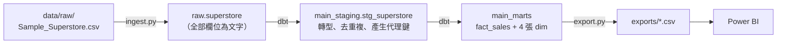
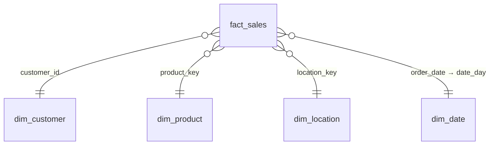

# superstore-de

把 Superstore 銷售資料（9,994 筆訂單明細）從原始 CSV 轉換成**經過測試的星狀模型**，供 Power BI 使用的資料工程專案。

使用 **DuckDB** 作為本機資料倉儲，以 **dbt** 管理資料轉換與資料品質測試。將在 notebook 與 Power BI 裡處理的清理和計算邏輯（日期解析、去除重複、折扣分組、月份欄位等），遷移到 dbt 中，以版本控制的 SQL 管理。

## 資料管線



| 層級 | 位置 | 類型 | 做什麼 |
|---|---|---|---|
| raw | `raw.superstore` | table | 原封不動載入 CSV，所有欄位都是文字，並加上 `_loaded_at`、`_source_file` 稽核欄位 |
| staging | `main_staging.stg_superstore` | view | 重新命名欄位、轉換型別、解析日期、去除重複、產生 `product_key` 和 `location_key` |
| marts | `main_marts.*` | table | 星狀模型：1 張事實表 + 4 張維度表 |

## 技術

- **DuckDB 2.0**：單一檔案的本機分析資料庫（`warehouse/superstore.duckdb`）
- **dbt-core 1.12 + dbt-duckdb**：SQL 轉換、資料血緣、資料品質測試
- **Python**：載入與匯出腳本
- **Power BI**：視覺化

## 如何執行

```bash
# 1. 建立虛擬環境並安裝套件
python -m venv .venv
source .venv/bin/activate
pip install -r requirements.txt

# 2. 載入原始資料 → raw.superstore（應該印出 loaded 9994 rows）
python scripts/ingest.py

# 3. 建立 staging / marts，並執行所有測試
dbt build

# 4. 測試全部通過後，匯出 marts 給 Power BI
python scripts/export.py
```

`profiles.yml` 放在專案根目錄，dbt 會自動讀取，不需要另外設定 `~/.dbt/`。

`dbt build` 只要有任何測試失敗，就不要執行第 4 步，以免把錯誤的資料交給報表。

## 資料模型



| 表 | 粒度 | 主鍵 | 筆數 |
|---|---|---|---|
| `fact_sales` | 一筆訂單明細 | `row_id` | 9,993 |
| `dim_customer` | 一位客戶 | `customer_id` | 793 |
| `dim_product` | 一個商品（ID + 名稱） | `product_key` | 1,894 |
| `dim_location` | 一個地點（城市 + 州） | `location_key` | 604 |
| `dim_date` | 一天 | `date_day` | 1,464 |

`fact_sales` 包含 `sales`、`quantity`、`discount`、`profit`，以及衍生欄位 `discount_group`（無折扣 / 1-20% / 30% 以上）和用來排序的 `discount_group_order`。

## 資料處理決策

在探勘原始資料時發現以下問題，處理方式如下：

| 發現 | 處理方式 | 位置 |
|---|---|---|
| CSV 欄位型別不可靠 | raw 層一律讀成文字（`all_varchar`），到 staging 才明確轉型 | `ingest.py`、`stg_superstore` |
| 日期混用 `11-08-2016` 和 `11/08/2016` 兩種寫法 | 先把 `-` 換成 `/` 再解析；用 `try_strptime`，解析失敗會變成 NULL，再由 `not_null` 測試抓出來，不會讓流程中途中斷 | `stg_superstore` |
| 有 1 組明細除了 `Row ID` 外完全相同（Row ID 3406 / 3407） | 視為重複輸入，保留 `row_id` 較小的一筆，因此 9,994 → 9,993 筆 | `stg_superstore` |
| 32 個 `Product ID` 對應到不只一個商品名稱 | 商品以「ID + 名稱」為單位，產生 `product_key = md5(product_id \| product_name)` | `stg_superstore` |
| 57 個城市名稱出現在不只一個州（例如 Springfield 出現在 4 個州） | 地點以「城市 + 州 + 區域」為單位，產生 `location_key` | `stg_superstore` |
| 報表需要連續的日曆 | 從最早訂單日到最晚出貨日，每天產生一列 | `dim_date` |

> **假設**：「除了 Row ID 外完全相同的兩筆明細是重複輸入」是業務判斷。如果實際上是同一張訂單中分兩次購買了相同商品，就不應該刪除。

## 資料品質測試

`dbt build` 會執行 23 個測試：

| 類型 | 內容 |
|---|---|
| 主鍵 | 每張表的主鍵都是 `unique` + `not_null` |
| 外鍵 | `fact_sales` 的 4 個 key 都能在對應的維度表中找到（`relationships`） |
| 必填 | `stg_superstore` 的 `order_date`、`ship_date` 不得為 NULL（抓出日期解析失敗的資料） |
| 允許值 | `discount_group` 只能是 3 個指定的分組 |
| `assert_row_count` | `fact_sales` 必須剛好 9,993 筆 |
| `assert_totals_match_notebook` | 總銷售額 2,296,919.4883、總利潤 286,409.0805，與 notebook 分析結果一致（容許誤差 0.01） |
| `assert_ship_not_before_order` | 出貨日不得早於訂單日 |
| `assert_order_date_range` | 訂單日期介於 2014-01-01 與今天之間 |

自訂測試放在 `tests/`，規則是：**查詢有回傳任何資料列，就代表測試失敗**。

## 專案結構

```
superstore-de/
├── data/raw/Sample_Superstore.csv   # 原始資料（從 superstore-analysis 專案複製）
├── scripts/
│   ├── ingest.py                    # 原始 CSV → DuckDB raw 層
│   └── export.py                    # marts → CSV 給 Power BI
├── models/
│   ├── staging/
│   │   ├── _sources.yml             # 宣告 raw.superstore 為 dbt source
│   │   ├── _staging.yml             # staging 測試
│   │   └── stg_superstore.sql
│   └── marts/
│       ├── _marts.yml               # marts 測試（主鍵、外鍵、允許值）
│       ├── fact_sales.sql
│       ├── dim_customer.sql
│       ├── dim_product.sql
│       ├── dim_location.sql
│       └── dim_date.sql
├── tests/                           # 自訂的資料品質測試
├── dbt_project.yml
├── profiles.yml
└── requirements.txt
```

`warehouse/`、`exports/`、`target/`、`logs/` 都是執行時產生的，已經列在 `.gitignore` 中。

## 已知限制與後續可以做的事

- schema 名稱是 dbt 預設組出來的 `main_staging` / `main_marts`；如果覆寫 `generate_schema_name`，`export.py` 也要跟著修改。
- 代理鍵用 `||` 串接，任何欄位為 NULL 時，key 也會變成 NULL；目前資料沒有這種情況，之後可以改用 `dbt_utils.generate_surrogate_key`。
- 外鍵欄位可以再加上 `not_null` 測試（`relationships` 測試會略過 NULL），並把 `ship_date` 也連到 `dim_date`。
- 依照新版 dbt 的建議，把 `relationships` / `accepted_values` 的參數移到 `arguments:` 底下，消除棄用警告。
